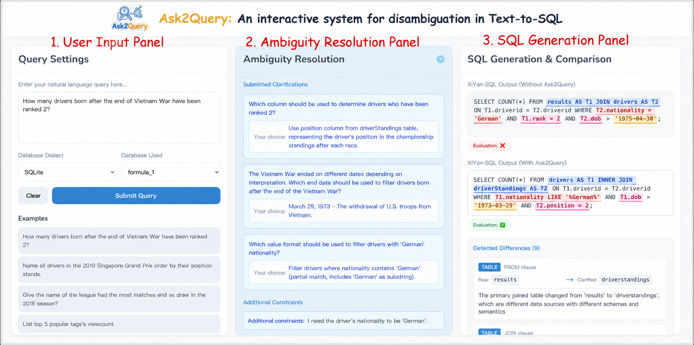

# Ask2Query 
### From Natural Language to SQL, with Clarity.

Ask2Query is an AI-powered assistant that helps users turn everyday questions into more precise database queries. Instead of immediately generating SQL from potentially confusing instructions, it identifies unclear parts of a question, asks users to resolve them, and then passes the refined request to a Text-to-SQL model.

The goal is simple: **help AI understand what you mean before asking it to generate SQL.**

## Why Ask2Query?

Natural-language questions don't always translate cleanly into database operations.

Consider this question:

> How many drivers born after the Vietnam War have been ranked 2?

What does *"after the Vietnam War"* mean in terms of an exact date? Does *"ranked 2"* refer to the `rank`, `position`, or `positionOrder` column?

A Text-to-SQL model might silently choose one interpretation and produce a query that executes successfully but answers the wrong question.

Ask2Query introduces an interactive clarification step to reduce these misunderstandings before SQL generation begins.

## ✨ What Can It Do?

- **Spot Unclear Intent:** Identify expressions that could have multiple meanings in a database query.
- **Guide the User:** Turn detected ambiguities into interactive questions with understandable answer choices.
- **Use Database Context:** Show relevant columns and sample records to help users choose the intended interpretation.
- **Refine the Question:** Combine the original request with the user's selections to create a more specific instruction.
- **Compare SQL Generation:** Examine the difference between SQL generated from an original question and its clarified version.
- **Evaluate the Output:** Compare generated queries against reference SQL in supported evaluation workflows.

## The Ask2Query Workflow

<p align="center">
  
</p>

### 1. Ask a question

Enter a request in plain English, choose the relevant database and SQL dialect, and submit it.

### 2. Resolve uncertainty

Ask2Query examines the question and presents clarification options for ambiguous expressions. Depending on the query, these options may involve selecting a date, choosing a database column, or adding a constraint.

### 3. Build a clearer request

Your selections are incorporated into a revised natural-language question that more closely represents what you want to retrieve.

### 4. Generate and compare SQL

The refined question is sent to a downstream Text-to-SQL model. You can compare the resulting SQL with the query generated from the original request and evaluate the results using the available comparison functionality.

## Built With

| Technology | Role |
|---|---|
| Python | Backend processing and application logic |
| Flask | Backend HTTP server |
| JavaScript / Node.js | Frontend development and tooling |
| LLM APIs | Language understanding, clarification, and query refinement |
| Text-to-SQL models | Translating refined questions into SQL |
| BIRD benchmark | Evaluation using benchmark database examples |

The exact model configuration and frontend framework depend on the source code and project setup.

## ⚡ Run It Locally

### Requirements

Install the following before getting started:

- Python 3.10
- Node.js and npm
- Git

You do **not** need Conda. The backend can use Python's built-in virtual environment support.

### 1. Get the code

```bash
git clone https://github.com/ampratapsingh/Ask2Query.git
cd Ask2Query
```

If you've created a separate Ask2Query repository, use that repository's URL instead.

### 2. Prepare Python

From the project root, create and activate a virtual environment:

**macOS / Linux**

```bash
python3 -m venv .venv
source .venv/bin/activate
```

**Windows PowerShell**

```powershell
python -m venv .venv
.venv\Scripts\Activate.ps1
```

Install the dependencies:

```bash
python -m pip install --upgrade pip
pip install -r requirements.txt
```

### 3. Prepare the benchmark data

For evaluation, the original project uses a subset of the [BIRD benchmark](https://bird-bench.github.io/).

Download the [MiniDev dataset](https://bird-bench.oss-cn-beijing.aliyuncs.com/minidev.zip), extract it, and place the database files where the backend expects them.

Check the code for the required directory structure before moving or renaming the extracted files.

### 4. Start the backend

Use the actual backend directory and entry-point file in your checkout. For example, if the project contains `server/server.py`:

```bash
cd server
python server.py
```

### 5. Start the frontend

Open a second terminal and navigate to the directory containing the frontend's `package.json`.

For example, if that directory is `frontend/`:

```bash
cd frontend
npm install
npm run dev
```

If the directory is named `chatbox/` in your version, use that path instead. Check the available scripts with `npm run` if the development command differs.

Keep both servers running while using the application.

## API Configuration

The original implementation references the following environment variables:

- `OPENAI_API_KEY`
- `MODELSCOPE_API_KEY`

Set the credentials required by the model integrations configured in your checkout. For example, on macOS or Linux:

```bash
export OPENAI_API_KEY="your_api_key"
export MODELSCOPE_API_KEY="your_api_key"
```

Use real credentials locally and keep them out of source control. Never expose secret API keys in frontend code or commit them to a public repository.

## Experiment With It

Try the same question twice:

1. Generate SQL directly from an ambiguous question.
2. Resolve the ambiguities through Ask2Query and generate SQL again.
3. Compare both outputs and, where supported, evaluate them against the reference query.

This provides a practical way to examine how clarifying user intent affects Text-to-SQL generation.

## Project Objective

Ask2Query explores a simple but important idea in AI-assisted database access: a model should not have to guess when a user's intent is unclear.

By combining language-model reasoning, database context, and user feedback, the system aims to make natural-language database querying more reliable and understandable.

## License

This project retains the original [Apache License 2.0](LICENSE), subject to the terms of the repository's license and any applicable attribution requirements.
